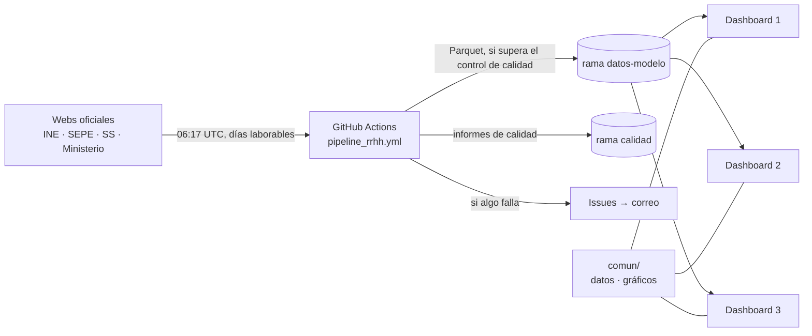

# Dashboard España · Empleo

Un solo origen de datos (pipeline diario con INE, SEPE, Seguridad Social y Ministerio de Trabajo) y varios dashboards
de Streamlit independientes que leen el mismo modelo. Es la misma lógica que `javiermcb/Datos_INE`, reorganizada para
alimentar varios dashboards desde un único repositorio y una única acción de carga.

## Arquitectura



| Carpeta | Qué contiene |
|---|---|
| `pipeline/` | Descarga, modelo, control de calidad y publicación (idéntico a `Datos_INE`). Configuración en `pipeline/config/` |
| `comun/` | Código compartido por todos los dashboards: lectura de datos (`datos.py`), gráficos, arranque (`base.py`) y páginas comunes (`paginas/`: estado de los datos, descargas). Cada dashboard declara en `arrancar(..., tablas=[...])` las tablas que usa y solo descarga esas |
| `dashboards/dashboard_1` … `dashboard_3` | Un dashboard cada uno: `app.py` (título y menú) y `paginas/` (lo propio). El 1 (jóvenes NEET), el 2 (empleo, actividad y sectores) y el 3 (FUNDAE) están hechos en lo que cubren los datos |
| `tests/` | Abre todas las páginas de todos los dashboards con la muestra `resultados/dev_modelo` (o con los datos publicados, si `RRHH_DATOS` apunta a ellos); comprueba además que cada dashboard carga solo sus tablas y que oculta el botón «Fullscreen» |
| `resultados/dev_modelo/` | Muestra del modelo para pruebas y desarrollo local |
| `_apartado/` | Código retirado y pendiente de borrar (acceso por email con registro): no se importa en ningún dashboard |
| `ops/` | Script que despierta las apps de Streamlit Community Cloud |
| `docs/` | Documentación heredada de `Datos_INE` (operación, tablas del modelo, catálogo de APIs, fuentes) |

## Workflows (`.github/workflows/`)

| Workflow | Cuándo | Qué hace |
|---|---|---|
| `pipeline_rrhh.yml` | días laborables 06:17 UTC, cambios en `pipeline/` | descarga, modelo, control de calidad y publicación en `datos-modelo` (solo desde `main`); avisa por issue si falla |
| `pipeline_pruebas.yml` | cambios en `pipeline/` y PRs | pruebas sin red del pipeline |
| `apps_pruebas.yml` | cambios en `dashboards/`, `comun/` | abre todas las páginas de todos los dashboards |
| `mantener_apps_activas.yml` | cada 4 horas | job `visitar`: abre con un navegador y despierta si duerme; visita las URLs `APP_URL_1`…`APP_URL_3` (variables del repositorio). Job `frescura`: abre una issue `datos-viejos` si la carga publicada en `datos-modelo` tiene más de 96 h (el pipeline dejó de publicar sin fallar) y la cierra cuando vuelve a estar al día |
| `prueba_tras_publicar.yml` | al terminar bien «Pipeline RRHH» en `main` | abre todas las páginas de todos los dashboards con los datos recién publicados en `datos-modelo`; si alguna falla, abre una issue `prueba-publicacion` |

Todos los workflows usan `ubuntu-24.04` (no `ubuntu-latest`) y las acciones fijadas por commit.

## Puesta en marcha

Guía paso a paso (datos, Streamlit, avisos, cuota de Actions): [`docs/guia_puesta_en_marcha.md`](docs/guia_puesta_en_marcha.md).

## Añadir un dashboard o una página

1. Páginas propias en `dashboards/dashboard_N/paginas/*.py`; se registran en el menú de `dashboards/dashboard_N/app.py`.
2. Si una página necesita una tabla nueva: añadirla al pipeline y a `TABLAS` en `comun/datos.py` (el control de calidad
   exige que estén las de esa lista) y declararla en `tablas=[...]` de la llamada a `arrancar()` en `app.py`; sin esa
   declaración el dashboard no la carga.
3. Lo que usen dos dashboards o más va a `comun/`.

## Ejecutar en local

```bash
pip install -r requirements.txt
RRHH_DATOS=resultados/dev_modelo streamlit run dashboards/dashboard_1/app.py
python -m pytest tests -q          # pruebas de los dashboards
python -m pytest pipeline/tests -q # pruebas del pipeline (pip install -r pipeline/requirements.txt)
```

## Despliegue (Streamlit Community Cloud)

Una app por dashboard, mismo repositorio y rama, distinto fichero principal (`dashboards/dashboard_N/app.py`).
Secretos de cada app (los mismos para todas):

```toml
RRHH_DATOS = "https://raw.githubusercontent.com/javiermcb/dashboard_-espa-a_empleo/datos-modelo/modelo/"
RRHH_DATOS_TOKEN = "github_pat_..."   # fine-grained, solo este repo, Contents: Read-only (repo privado)
```

Los dashboards son públicos: sin login ni registro de visitas.

## Versiones fijadas y cómo actualizar

`requirements.txt` (apps) y `pipeline/requirements.txt` (pipeline) fijan versiones exactas. Para actualizar: cambiar la
versión, ejecutar `python -m pytest -q` y subir; GitHub vuelve a probar todas las páginas y, si cambia el pipeline,
ejecuta una carga completa en la rama. Estado a 26/10/2026: Streamlit 1.66.1, pandas 3.1.0, pyarrow 26.0.0, altair 6.3.0,
DuckDB **1.5.6**. DuckDB 2.0.0 (versión mayor) no se ha adoptado: el SQL de `pipeline/marts.sql` ya es compatible con
las dos versiones y las pruebas pasan con ambas, pero falta ejecutar una carga completa con la 2.0.0.

## Incrustar un dashboard en otra web (WordPress)

```html
<iframe src="https://<app>.streamlit.app/?embed=true"
  style="width:100%;height:85vh;min-height:520px;border:0;display:block;"
  loading="lazy"></iframe>
```

- El código oculta el botón «Fullscreen» de la barra que sale al pasar el ratón por un gráfico (CSS en `comun/base.py`;
  `arrancar(..., pantalla_completa=True)` lo restaura). Depende de un atributo interno de Streamlit: revisarlo al
  actualizar de versión (lo vigila `tests/test_dashboards.py::test_sin_boton_pantalla_completa`).
- La barra «Built with Streamlit / Fullscreen» del pie la añade Streamlit Community Cloud alrededor de la app y no se
  puede quitar desde el código. Se puede recortar visualmente añadiendo al `style` del iframe
  `clip-path:inset(0 0 32px 0);margin-bottom:-32px;` (ajustar el valor a la altura real de la barra; recorta también el
  final del contenido y puede incumplir las condiciones de Streamlit).

## Licencia

© Fundación Gi Group. Sin licencia: todos los derechos reservados. Aunque el repositorio sea público, no se concede permiso para usar, copiar, modificar ni distribuir el código (ver `LICENSE`). Los datos de INE, SEPE, Seguridad Social, Ministerio de Trabajo y FUNDAE son de sus fuentes y se reutilizan según las condiciones de cada una.

## Pendiente de decidir

- Dashboard 1: nivel educativo y urbano/rural de los NEET, y cifras 16-29 (ver `docs/dashboard_1_fuentes.md`).
- Dashboard 2: UE-27, sectores con potencial, competencias y tipo de contrato por edad.
- Dashboard 3: sin crédito asignado/disponible (FUNDAE solo publica el «dispuesto»).

Decidido (26/10/2026): `Datos_INE` y este repositorio son proyectos distintos y mantienen cada uno su propia carga diaria.
Decidido (26/10/2026): el código no lleva licencia (todos los derechos reservados).
