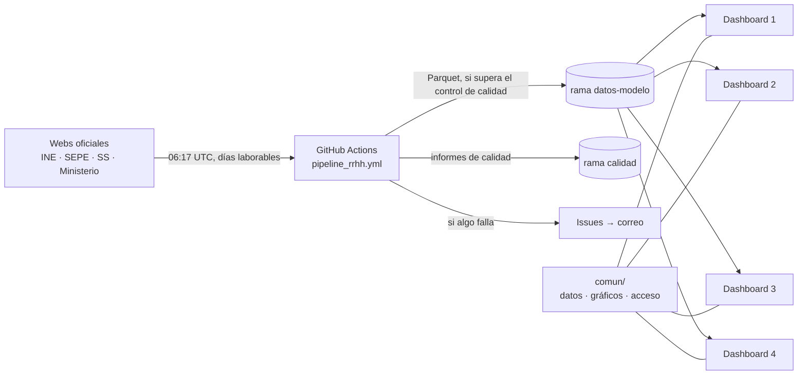

# Dashboard España · Empleo

Un solo origen de datos (pipeline diario con INE, SEPE, Seguridad Social y Ministerio de Trabajo) y varios dashboards
de Streamlit independientes que leen el mismo modelo. Es la misma lógica que `javiermcb/Datos_INE`, reorganizada para
alimentar varios dashboards desde un único repositorio y una única acción de carga.

## Arquitectura



| Carpeta | Qué contiene |
|---|---|
| `pipeline/` | Descarga, modelo, control de calidad y publicación (idéntico a `Datos_INE`). Configuración en `pipeline/config/` |
| `comun/` | Código compartido por todos los dashboards: lectura de datos (`datos.py`), gráficos, acceso por email, arranque (`base.py`) y páginas comunes (`paginas/`: estado de los datos, descargas, administración) |
| `dashboards/dashboard_1` … `dashboard_4` | Un dashboard cada uno: `app.py` (título y menú) y `paginas/` (lo propio). De momento solo una página de inicio por definir |
| `tests/` | Abre todas las páginas de todos los dashboards con la muestra `resultados/dev_modelo` |
| `resultados/dev_modelo/` | Muestra del modelo para pruebas y desarrollo local |
| `ops/` | Script que despierta las apps de Streamlit Community Cloud |
| `docs/` | Documentación heredada de `Datos_INE` (operación, tablas del modelo, catálogo de APIs, fuentes) |

## Workflows (`.github/workflows/`)

| Workflow | Cuándo | Qué hace |
|---|---|---|
| `pipeline_rrhh.yml` | días laborables 06:17 UTC, cambios en `pipeline/` | descarga, modelo, control de calidad y publicación en `datos-modelo` (solo desde `main`); avisa por issue si falla |
| `pipeline_pruebas.yml` | cambios en `pipeline/` y PRs | pruebas sin red del pipeline |
| `apps_pruebas.yml` | cambios en `dashboards/`, `comun/` | abre todas las páginas de todos los dashboards |
| `mantener_apps_activas.yml` | cada 4 horas | visita las URLs `APP_URL_1`…`APP_URL_4` (variables del repositorio) |

## Añadir un dashboard o una página

1. Páginas propias en `dashboards/dashboard_N/paginas/*.py`; se registran en el menú de `dashboards/dashboard_N/app.py`.
2. Si una página necesita una tabla nueva: añadirla al pipeline y a `TABLAS` en `comun/datos.py` (el control de calidad
   exige que estén las de esa lista).
3. Lo que usen dos dashboards o más va a `comun/`.

## Ejecutar en local

```bash
pip install -r requirements.txt
RRHH_DATOS=resultados/dev_modelo streamlit run dashboards/dashboard_1/app.py
python -m pytest tests -q          # pruebas de los dashboards
python -m pytest pipeline/tests -q # pruebas del pipeline (pip install -r pipeline/requirements.txt)
```

## Despliegue (Streamlit Community Cloud)

Una app por dashboard, mismo repositorio y rama, distinto fichero principal (`dashboards/dashboard_N/app.py`).
Secretos de cada app (los mismos para todas):

```toml
RRHH_DATOS = "https://raw.githubusercontent.com/javiermcb/dashboard_-espa-a_empleo/datos-modelo/modelo/"
RRHH_DATOS_TOKEN = "github_pat_..."   # fine-grained, solo este repo, Contents: Read-only (repo privado)
```

El acceso con registro (`comun/acceso.py`) usa además los secretos `RRHH_LOG_*`, `RRHH_ADMIN_*` y `RRHH_HASH_CLAVE`
descritos en ese fichero. Sin ellos, entra cualquier email y no se guarda nada. Para un dashboard sin acceso:
`acceso=False` en su `app.py`.

## Pendiente de decidir

- Qué responde cada dashboard (nombre, público, páginas, tablas).
- Si todos comparten el registro de accesos (`Datos_INE_registro`) o cada uno el suyo.
- Si el pipeline sigue también en `Datos_INE` o pasa a ejecutarse solo aquí.
